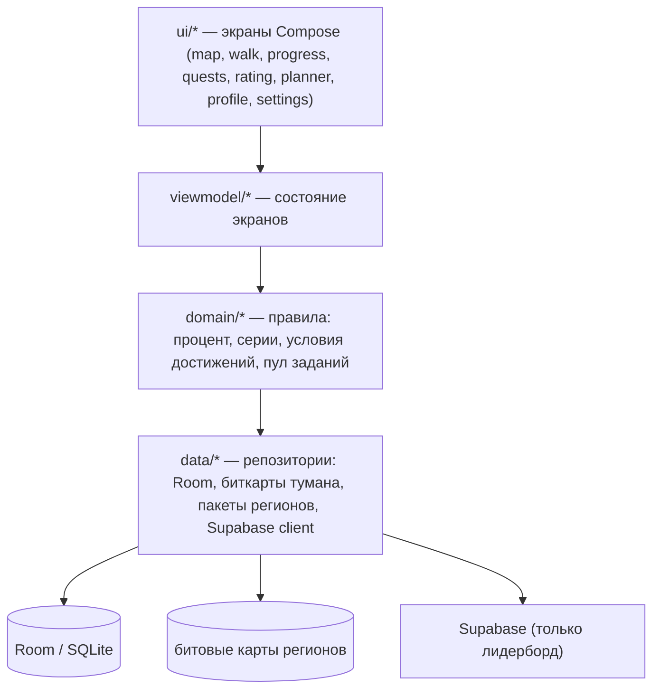
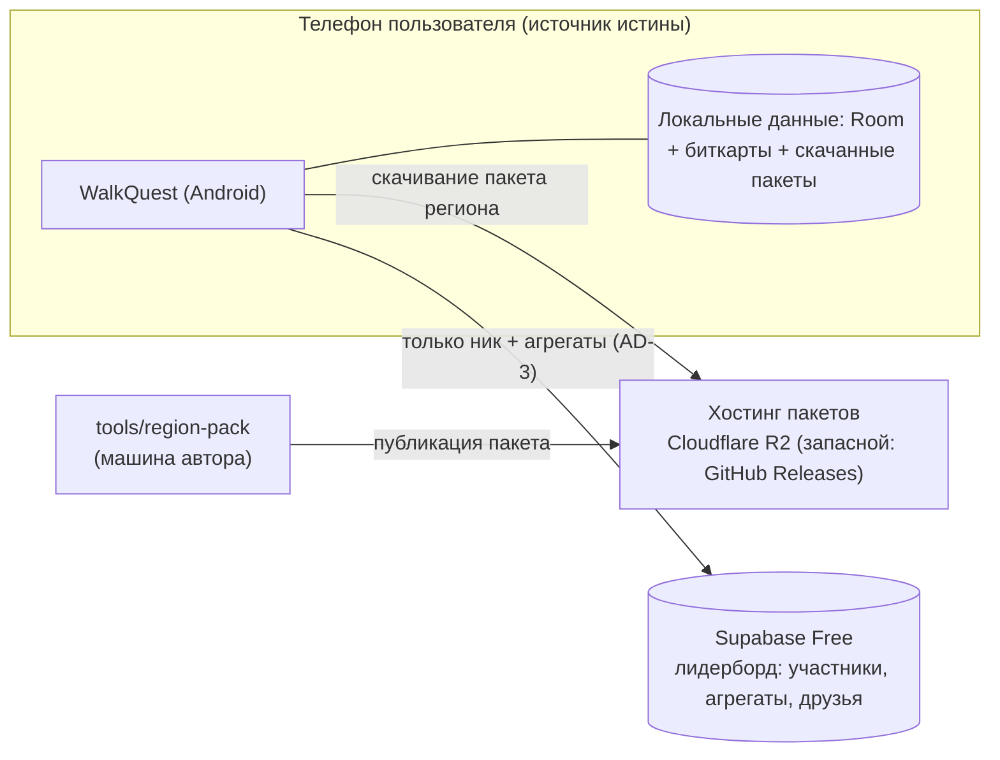
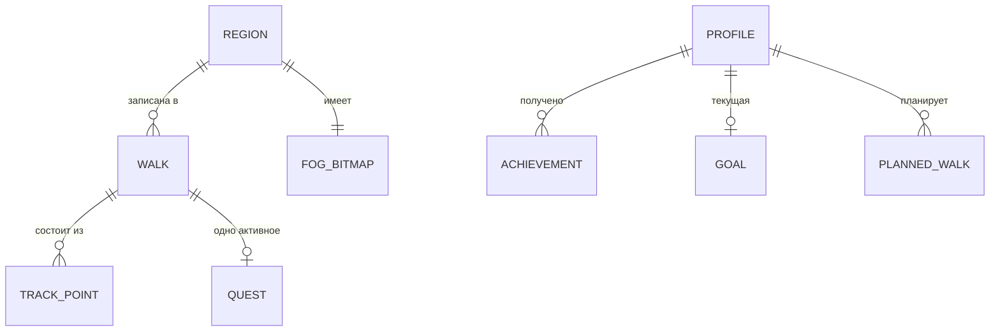

# Architecture Spine — WalkQuest

## Design Paradigm

**MVVM + UDF на Jetpack Compose, одна Activity.** Экраны (Compose) только рендерят состояние и отправляют события; бизнес-правила (подсчёт процента, серии, проверка условий достижений, раздача заданий) живут в domain-слое и не зависят от Android-фреймворка; данные — за репозиториями. Один gradle-модуль: соло-проекту многомодульность не нужна, но границы пакетов — жёсткие (см. диаграмму зависимостей в AD-10).

## Invariants & Rules

### AD-1 — Картографический движок: MapLibre Native Android [ADOPTED]

- **Binds:** FR-1, FR-3, FR-4, FR-18
- **Prevents:** расхождение «карта как в привычных приложениях» (поворот, плавный зум) с растровым движком; зависимость от платных SDK
- **Rule:** базовая карта — векторные тайлы OSM через `org.maplibre.gl:android-sdk` (линия 13.x, Vulkan по умолчанию; при проблемах на устройствах — артефакт `android-sdk-opengl`). Туман — кастомный слой с собственной геометрией поверх базовой карты, не модификация тайлов. Никаких платных картографических SDK и данных Яндекс/2ГИС.

### AD-2 — Офлайн-first [ADOPTED]

- **Binds:** FR-1, FR-3, FR-5, FR-13
- **Prevents:** ситуация «прогулка не засчиталась, потому что нет сети»
- **Rule:** весь базовый цикл — карта, запись трека, растуманивание, статистика, достижения, задания — работает без сети. Сеть нужна ровно для двух вещей: скачивание пакета региона и лидерборд. Любая новая фича, требующая сети в базовом цикле, — конфликт, выносится на пересмотр.

### AD-3 — Приватность: треки не покидают устройство [ADOPTED]

- **Binds:** FR-19, FR-20, FR-21
- **Prevents:** утечку истории перемещений на сервер по инерции («просто зальём всё, разберёмся потом»)
- **Rule:** на сервер уходят только ник и агрегированные метрики лидерборда (суммарное расстояние, проценты по регионам). Координаты, треки, история прогулок сервер не принимает и не хранит. Локальные логи и краш-репорты не содержат координат. Перенос данных — экспорт/импорт файла по инициативе пользователя; облачная синхронизация отклонена.

### AD-4 — Туман: битовые карты, единый владелец процента

- **Binds:** FR-1, FR-2, FR-13, FR-15
- **Prevents:** два экрана, считающих «процент открытия» по-разному; раздутие хранилища записями на каждый тайл
- **Rule:** состояние открытия региона — битовая карта (бит = тайл), один файл на регион. Процент открытия = открытые проходимые биты / все проходимые биты пакета, вычисляется только в domain (`progress`), UI и лидерборд берут готовое значение. Сетка тайлов едина для региона и задаётся на этапе генерации пакета; размер тайла — параметр пакета (см. Deferred). Биты открываются **только** через domain после фильтрации точек трека (лимит скорости, отсечение телепортаций — `tracking`): ни UI, ни слой MapLibre не открывают тайлы сами.

### AD-5 — История и контент: Room/SQLite, трек пишется инкрементально

- **Binds:** FR-5, FR-13, FR-15, FR-16, FR-17, FR-20, FR-21
- **Prevents:** потерю прогулки при убийстве процесса; рассинхрон статистики и «настоящей» истории
- **Rule:** прогулки, точки треков, достижения, задания, планировщик, настройки цели — SQLite через Room, источник истины на устройстве. Точки трека во время записи пишутся append-only по мере поступления: принудительное завершение процесса теряет секунды, а не прогулку. Запись — foreground-сервис с постоянным уведомлением (требование платформы).

### AD-6 — Пакеты регионов: офлайн-генерация, приложение только скачивает [ADOPTED]

- **Binds:** FR-2, FR-4, FR-18
- **Prevents:** ползучий рост серверной инфраструктуры («собирать города на лету») без людей и бюджета
- **Rule:** пакет региона (векторные тайлы, сетка проходимости, границы, POI с описаниями) собирается скриптом на машине автора из OSM + Википедии и публикуется на статическом хостинге. Приложение скачивает готовый пакет, проверяет версию формата и целостность. Серверного пайплайна сборки нет. Пакеты **не** раздаются через Supabase (лимит трафика бесплатного тарифа ~10 ГБ/мес исчерпается десятками скачиваний).

### AD-7 — Бэкенд лидерборда: Supabase, только лидерборд [ADOPTED]

- **Binds:** FR-19
- **Prevents:** превращение «одной таблички рейтинга» в самописный сервер; утечку периметра приватности
- **Rule:** Supabase (бесплатный тариф: 500 МБ Postgres, 50 тыс. MAU, неограниченные API-запросы; проект засыпает после 7 дней неактивности — при живых пользователях не критично, до запуска держать keep-alive). Таблицы: участники (ник), агрегаты по регионам, дружеские связи. Row Level Security обязательна. Синхронизация — при завершении прогулки и по ручному обновлению; мгновенной синкронизации нет. Друзья — по ссылке-приглашению. Никаких других данных на Supabase.

### AD-8 — Числовые пороги и прототип карты как гейт

- **Binds:** NFR (производительность, батарея, размер), FR-5
- **Prevents:** старт разработки фич на непроверенном фундаменте
- **Rule:** до начала эпиков, зависящих от карты, технический прототип (карта + туман + запись трека на реальном устройстве среднего сегмента) обязан подтвердить: ≥ 30 fps рендера карты с туманом; пакет региона ≤ 50 МБ; расход батареи при фоновой записи ≤ 5%/час с выключенным экраном; APK ≤ 30 МБ без пакетов. Неподтверждённый порог — блокер, возвращаемся к spine.

### AD-9 — Модель территории [ADOPTED]

- **Binds:** FR-2, FR-4, FR-15, контент-каталог (достижения A-группы)
- **Prevents:** смешение «город» и «область» в процентах и достижениях (краевой случай: Гатчина — отдельный город в Ленобласти, не часть СПб)
- **Rule:** иерархия фиксирована: город (населённый пункт) → регион (субъект) → районы (только в городах с административным делением). Процентные достижения считаются по городу; статистика и лидерборд — по региону. Границы — из OSM, поставляются в пакете региона. Принадлежность прогулки региону определяется только в domain по границам пакета — не «по текущему экрану карты».

### AD-10 — Границы пакетов и направление зависимостей

- **Binds:** all
- **Prevents:** протечку Android/сетевых деталей в правила игры; циклические зависимости между фичами
- **Rule:** зависимости только вниз по диаграмме; domain не импортирует Android SDK, MapLibre и сетевых клиентов; фичи не импортируют друг друга — общее только через `domain` и `data`.



## Consistency Conventions

| Concern | Convention |
| --- | --- |
| Naming (код ↔ глоссарий) | Прогулка → `Walk`, Регион → `Region`, Тайл → `Tile`, Туман → `Fog`, Цель → `Goal`, Ачивка → `Achievement`, Челлендж/Задание → `Quest`, POI → `Poi`, Серия → `Streak`, Лидерборд → `Leaderboard`. Идентификаторы достижений/заданий — из контент-каталога (A1…E4, T1…T22), не переизобретаются |
| Data & formats | id — UUID; даты/время — epoch millis UTC, локализация на UI; дни для Серий и целей — по локальному календарю устройства; пакет региона и файл экспорта — версионируемые форматы (поле `formatVersion` с первого релиза); проценты хранятся как доля, форматирование («17,4%») — только на UI |
| State & mutation | Все изменения данных — только через репозитории `data`; domain чистый (Kotlin, без Android); асинхронность — coroutines/Flow; ошибки — sealed-результаты, не исключения через границы слоёв |
| Контентная логика | Одно активное задание за раз; отказ без штрафа («задание снято»); выполнение на честном слове; условия достижений проверяются после каждой завершённой прогулки (новые достижения из обновлений — задним числом по истории) |
| Логирование | Локальные логи без координат и маршрутов (AD-3) |

## Stack

| Name | Version |
| --- | --- |
| Kotlin | 2.3.x (проверено 2026-10-01: 2.3.10) |
| Jetpack Compose | BOM 2026.09.00 (ядро 1.12, проверено 2026-10-01) |
| MapLibre Native Android | 13.5.x (`org.maplibre.gl:android-sdk`, Vulkan; запасной `android-sdk-opengl`) |
| Room (SQLite) | 2.8.x (проверено 2026-10-01: 2.8.5; линия Room 3.0 сменила Maven-координаты — в v1 не мигрируем) |
| supabase-kt | 3.8.x (проверено 2026-10-01: 3.8.0) |
| Google Play Services Location (FusedLocationProvider) | актуальная стабильная — пин при создании проекта |
| Coroutines / Flow / Lifecycle / Navigation Compose / DataStore | из Compose BOM и androidx stable |
| minSdk / targetSdk | 29 (Android 10) / актуальный на момент bootstrap |
| Пайплайн пакетов (скрипт) | Python 3 + osmium/pmtiles-инструменты — состав определяется первой сборкой |

## Structural Seed

```text
walkquest/
  app/
    src/main/java/app/walkquest/
      ui/         # экраны Compose по фичам: map, walk, final, progress, quests, rating, regions, planner, profile, settings, onboarding
      viewmodel/  # состояние экранов, события
      domain/     # правила игры: territory, fog-percent, streaks, achievements, quests — чистый Kotlin
      data/       # репозитории: room/, fog/ (биткарты), packages/ (скачивание и распаковка), leaderboard/ (Supabase)
      tracking/   # foreground-сервис записи, лимит скорости, автопауза, батарейный страж
      di/         # ручное внедрение зависимостей (без Hilt на v1)
  tools/
    region-pack/  # скрипт генерации пакета региона (OSM → тайлы, проходимость, границы, POI)
```



Пакет региона (один файл-архив, версионируемый):

```text
region-{id}-v{n}.zip
  style.json + tiles.pmtiles   # векторная карта для MapLibre
  walkability.grid             # проходимые тайлы (знаменатель процента)
  boundaries.geojson           # границы города/региона/районов (AD-9)
  poi.json                     # точки интереса + описания (OSM + Википедия)
  meta.json                    # formatVersion, размер тайла, контрольные суммы
```



## Capability → Architecture Map

| Capability / Area | Lives in | Governed by |
| --- | --- | --- |
| Карта и туман (FR-1…FR-4) | `ui/map`, `domain` (fog-percent), `data/fog`, `data/packages` | AD-1, AD-2, AD-4, AD-8, AD-9 |
| Трекинг прогулки (FR-5…FR-10) | `tracking`, `data/room` | AD-2, AD-3, AD-5, AD-8 |
| Цели, обучение, статистика (FR-11…FR-14) | `ui/onboarding`, `ui/progress`, `domain` (streaks) | AD-4, AD-5 |
| Ачивки (FR-15) | `domain/achievements`, `data/room` | AD-4, AD-5, AD-9 + content-catalog |
| Челленджи (FR-16) | `ui/quests`, `domain/quests` | AD-5 + конвенция «одно активное» |
| Планировщик (FR-17) | `ui/planner`, `data/room` | AD-5 |
| POI (FR-18) | `ui/map`, `data/packages` | AD-1, AD-2, AD-6 |
| Лидерборд (FR-19) | `ui/rating`, `data/leaderboard` | AD-3, AD-7 |
| Аккаунт и данные (FR-20, FR-21) | `data/room`, `data` (export/import) | AD-3, AD-5 |

## Deferred

- **Размер тайла сетки** — параметр пакета, определяется техническим прототипом (PRD OQ-2); spine фиксирует только единство сетки внутри региона.
- **Точные лимиты скорости** (пеший ~12 км/ч, вело ~30 км/ч — гипотезы) — полевые тесты на прототипе (PRD OQ-1).
- **Хостинг пакетов: R2 vs GitHub Releases** — выбор при сборке первого пакета; решение обратимо, не блокирует эпики.
- **Частота уведомлений во время прогулки** — подбирается на UX/полевых тестах, настраивается пользователем (PRD FR-9).
- **Автоматическая сборка пакетов по запросу** («любой город сам») — осознанное желание на будущее; v1 живёт на ручной генерации (AD-6), архитектура путь не закрывает: смена источника пакетов локализована в `data/packages`.
- **Состав инструментов region-pack** (osmium, tilemaker/pmtiles и т.п.) — определяется первой сборкой.
- **DI-фреймворк** — v1 ручной; Hilt добавляется только если ручной стал мешать.
- **Релизный контур Google Play** — декларация background location, политика конфиденциальности, возрастной рейтинг (PRD OQ-6): чек-лист перед публикацией, на архитектуру v1 не влияет.
- **iOS, монетизация, облачная синхронизация** — вне v1 (PRD Non-Goals).
